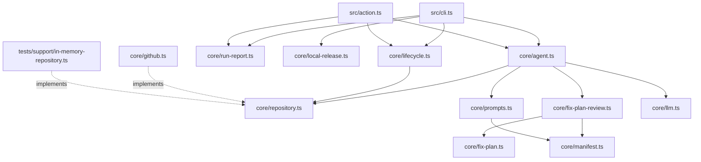

# Architecture

Current state of `gh-bump` as implemented on `main`. Domain vocabulary lives in
[CONTEXT-MAP.md](../CONTEXT-MAP.md) and the per-context glossaries; this document
maps responsibilities to files and traces how work flows through them.

## 1. What the system does

`gh-bump` turns open Dependabot alerts on a GitHub repository into reviewable
pull requests. An LLM decides the fix, so no ecosystem-specific fix logic is
hardcoded. It ships as two entrypoints over one core: a CLI binary and a GitHub
Action.

A second, unrelated workflow (`--full-run`) prepares and optionally publishes a
local npm patch release. It shares only logging and CLI plumbing with the
remediation flow.

### Non-goals

- Cloning repositories. All repository reads and writes go through the GitHub
  API.
- Regenerating lockfiles. Fix plans change manifests only; lockfile refresh is
  left to CI or Dependabot.
- Merging without human intent. Merge, tag and release only run when explicitly
  requested via flags/inputs.
- Reaching the network from the local release workflow beyond `npm` itself. No
  AI or GitHub API calls happen in `--full-run`.

## 2. External actors and systems

| Actor / system | Interaction | Reached from |
| --- | --- | --- |
| Operator (CLI) | Runs `gh-bump --repo=owner/repo` | [src/cli.ts](../src/cli.ts) |
| GitHub Actions runner | Supplies inputs, consumes outputs | [src/action.ts](../src/action.ts), [action.yml](../action.yml) |
| GitHub REST API | Alerts, contents, git data, PRs, releases | [src/core/github.ts](../src/core/github.ts) |
| LLM provider (GitHub Models / OpenAI / Anthropic) | Produces the fix plan | [src/core/llm.ts](../src/core/llm.ts) |
| npm registry | `npm update` / `npm publish` in `--full-run` | [src/core/local-release.ts](../src/core/local-release.ts) |

## 3. Components

Two adapters sit above one core. Nothing in `src/core/` imports `@actions/core`
or `node:util`'s `parseArgs`; entrypoints own all input parsing and all output
rendering.

| Component | Path | Responsibility |
| --- | --- | --- |
| CLI adapter | [src/cli.ts](../src/cli.ts) | Parse flags, read env, dispatch to remediation or local release, render report |
| Action adapter | [src/action.ts](../src/action.ts) | Read Action inputs, run the same core, set Action outputs |
| Repository ports | [src/core/repository.ts](../src/core/repository.ts) | `RepositoryPort` and `LifecyclePort` — the only repository surface the core depends on |
| GitHub adapter | [src/core/github.ts](../src/core/github.ts) | `GitHubClient implements RepositoryPort, LifecyclePort` over Octokit |
| Security remediation | [src/core/agent.ts](../src/core/agent.ts) | `runAgent()` — alerts to remediation pull requests |
| Fix plan admission | [src/core/fix-plan-review.ts](../src/core/fix-plan-review.ts) | `reviewFixPlan()` — the single admit/reject decision |
| Fix plan parsing | [src/core/fix-plan.ts](../src/core/fix-plan.ts) | `parseFixPlan()` — model text to a typed `FixPlan` |
| Fix plan summary | [src/core/fix-plan-summary.ts](../src/core/fix-plan-summary.ts) | Dry-run rendering of what a plan would change |
| Manifest knowledge | [src/core/manifest.ts](../src/core/manifest.ts) | Lockfile mapping, alert grouping, `package.json` parsing and mutable-path policy |
| Repository lifecycle | [src/core/lifecycle.ts](../src/core/lifecycle.ts) | `runRepositoryLifecycle()` — merge, tag, release after the PR exists |
| Run reporting | [src/core/run-report.ts](../src/core/run-report.ts) | `buildRunReport()` — outcome counts, lines, summary, exit code |
| Prompts | [src/core/prompts.ts](../src/core/prompts.ts) | `SYSTEM_PROMPT`, `buildAlertPrompt()` |
| LLM client | [src/core/llm.ts](../src/core/llm.ts) | Provider-agnostic `generateText()` wrapper |
| Config | [src/core/config.ts](../src/core/config.ts) | `normalizeConfig()` — validation shared by both adapters |
| CLI mode rules | [src/core/cli-mode.ts](../src/core/cli-mode.ts) | Which flags `--full-run` refuses |
| Local release | [src/core/local-release.ts](../src/core/local-release.ts) | `createLocalReleasePlan()`, `runLocalRelease()` |
| Logging | [src/core/log.ts](../src/core/log.ts) | CLI colors vs GitHub Actions `::group::` / `::warning::` annotations |
| Types | [src/core/types.ts](../src/core/types.ts) | `Config`, `DependabotAlert`, `FixPlan`, `AgentResult`, `RemediationArtifact` |

### Dependency direction



Prohibited edges, each currently held:

- `agent.ts` must not import `github.ts`. It depends on `RepositoryPort` only,
  which is what makes `runAgent()` testable without network access.
- `agent.ts` must not merge, tag or release. That belongs to `lifecycle.ts`
  (see [ADR-0001](adr/0001-bounded-context-split-and-lifecycle-boundaries.md)).
- `local-release.ts` must not import `github.ts` or `llm.ts`
  (Local-Only Execution Boundary).
- Adapters must not re-derive counts or exit codes; they render `RunReport`.

## 4. Remediation flow

Entry: `runAgent(gh, llm, config, repo)` in
[src/core/agent.ts](../src/core/agent.ts).

1. `gh.listAlerts(repo, config.severity)` fetches open alerts. Zero alerts
   returns a single `success` result with no artifact.
2. Alerts are truncated to `config.maxAlerts` (Workload Cap Policy).
3. `gh.getDefaultBranch()` then `gh.getBranchSha()` establish the base commit
   every group branches from.
4. `groupAlertsByManifest()` keys alerts by editable manifest path, remapping
   lockfile paths through `resolveManifestFromLockfile()`. One group becomes at
   most one pull request, which is what keeps concurrent edits from colliding.
5. Per group:
   1. In Unattended Merge Mode, an unverifiable manifest records `no-fix` and
      skips planning. Currently only `package.json` is verifiable.
   2. `fetchEditableManifests()` reads each non-lockfile manifest at the default
      branch. Unreadable paths are warned about and omitted — this set doubles as
      the write allowlist in step 5.5.
   3. If `llmCalls >= config.maxLlmCalls`, the group records `budget-stop` and
      the loop continues. No LLM call is made.
   4. `llm.call()` runs with `SYSTEM_PROMPT`, the alert prompt, and — for
      providers other than `github` — the `read_file` / `list_directory` tools.
      A thrown error records `failed`.
   5. `reviewFixPlan(response, groupAlerts, fetchedManifests)` parses the
      response and applies the scope, content-boundary and npm dependency rules.
      Rejection records `no-fix` with the reason.
   6. In dry-run, the plan is printed and the group records `success` with **no**
      artifact. Nothing is written.
   7. Otherwise `createBranch` → `commitFiles` → `createPR`, and the group
      records `success` with a `RemediationArtifact`. A thrown error records
      `failed`.
6. `runAgent()` returns `AgentResult[]` — one entry per group attempt.

Commits never touch a working tree. `GitHubClient.commitFiles()` creates blobs,
builds a tree on the parent commit's tree, creates a commit, then fast-forwards
the branch ref.

Then the adapter calls, in order:

1. `runRepositoryLifecycle(gh, config, results)` — no-ops unless `merge`,
   `release` or `tag` is set and the run is not a dry run. For each result that
   carries an artifact it merges, and on success derives the tag/release version
   from the PR title via `/\d+\.\d+\.\d+/`. A title without a version logs a
   warning and skips tagging. A step that throws is recorded as a
   `LifecycleFailure` and the next artifact is still processed.
2. `buildRunReport(results, { dryRun, lifecycleFailures })` — the only place
   counts, the summary string and the exit code are derived.

### Failure and retry behavior

- Outcomes are per group attempt, not per run: `success`, `no-fix`, `failed`,
  `budget-stop`.
- A `no-fix` is terminal for the run. There is no in-run retry loop; changing the
  outcome requires a new run with different inputs or configuration.
- `budget-stop` is policy enforcement, not a defect. It is counted and reported
  separately and does not affect the exit code.
- The process exits non-zero when at least one group is `failed` or any
  lifecycle step failed (`RunReport.exitCode`). The Action does not fail on
  `no-fix` or `budget-stop` — it emits `core.warning` — but does `setFailed` on
  a lifecycle failure.
- A lifecycle failure never discards the report. `runRepositoryLifecycle()`
  records the failure per artifact and continues, so pull requests that were
  created are still counted and emitted as outputs.
- Steps within a group are not transactional. A failure after `createBranch` can
  leave an orphan branch behind; nothing cleans it up.

## 5. Local release flow

Entry: `runLocalRelease()` in
[src/core/local-release.ts](../src/core/local-release.ts), reached only from
`src/cli.ts` when `--full-run` is passed. `findFullRunIncompatibleOptions()`
rejects the flag combination before any command runs.

`createLocalReleasePlan()` builds the command list from the local
`package.json`: `npm update --package-lock-only`, `npm version patch
--no-git-tag-version`, then `npm test`, `npm run build:check` and `npm run
build` **only if those scripts exist**, then `npm publish` only when `--publish`
is set.

Preconditions and semantics:

- Clean worktree is required before any mutation (`git status --porcelain`).
- `npm whoami` gates publish; publish additionally requires `--publish` and a
  non-dry run.
- Steps apply in order and are not rolled back. A late failure leaves the
  earlier local mutations (updated lockfile, bumped version) in the working
  tree; that diff is the intended artifact for human adjudication.
- Dry run prints the plan and runs no shell commands.

## 6. Invariants

| Invariant | Enforced in | Covered by |
| --- | --- | --- |
| A fix plan may only write files that were fetched for that group | `scopeBoundaryViolation()` in [fix-plan-review.ts](../src/core/fix-plan-review.ts) | [tests/fix-plan-review.test.ts](../tests/fix-plan-review.test.ts) |
| A fix plan may never write a lockfile | `scopeBoundaryViolation()` via `isLockfilePath()` | [tests/fix-plan-review.test.ts](../tests/fix-plan-review.test.ts) |
| A `package.json` fix may only change declared dependency and override paths | `contentBoundaryViolation()` via `PACKAGE_JSON_MUTABLE_PATHS` | [tests/fix-plan-review.test.ts](../tests/fix-plan-review.test.ts) |
| Unattended merging never plans a fix for an unverifiable manifest | `config.merge` gate via `isVerifiableManifestPath()` | [tests/agent.test.ts](../tests/agent.test.ts) |
| An npm fix may not add a new direct dependency | `npmDirectDependencyViolation()` | [tests/fix-plan-review.test.ts](../tests/fix-plan-review.test.ts) |
| Dry run creates no branch, commit or PR | `config.dryRun` branch in `runAgent()` | [tests/agent.test.ts](../tests/agent.test.ts) |
| Dry run produces no remediation artifact | same branch — `createResult(..., null)` | [tests/agent.test.ts](../tests/agent.test.ts) |
| LLM calls never exceed `maxLlmCalls` | budget check in `runAgent()` | [tests/agent.test.ts](../tests/agent.test.ts) |
| Alerts processed never exceed `maxAlerts` | `alerts.slice(0, config.maxAlerts)` | [tests/agent.test.ts](../tests/agent.test.ts) |
| Merge/tag/release never run inside remediation | absent from `agent.ts`; only in `lifecycle.ts` | [tests/lifecycle.test.ts](../tests/lifecycle.test.ts) |
| Lifecycle never runs in dry-run | guard in `runRepositoryLifecycle()` | [tests/lifecycle.test.ts](../tests/lifecycle.test.ts) |
| A lifecycle failure never discards the run report | try/catch per artifact in `runRepositoryLifecycle()`, surfaced via `buildRunReport()` | [tests/lifecycle.test.ts](../tests/lifecycle.test.ts), [tests/run-report.test.ts](../tests/run-report.test.ts) |
| "lock" in a directory or file name does not make a manifest a lockfile | `LOCKFILE_NAME_PATTERN` matches the basename only | [tests/manifest.test.ts](../tests/manifest.test.ts) |
| `--release` / `--tag` imply `--merge` | `normalizeConfig()` | [tests/config.test.ts](../tests/config.test.ts) |
| Exit code is non-zero only on `failed` | `buildRunReport()` | [tests/run-report.test.ts](../tests/run-report.test.ts) |
| One PR per editable manifest | `groupAlertsByManifest()` | [tests/manifest.test.ts](../tests/manifest.test.ts) |
| `--full-run` refuses remediation flags | `findFullRunIncompatibleOptions()` | [tests/cli-mode.test.ts](../tests/cli-mode.test.ts) |
| Publish requires intent, non-dry-run and npm auth | publish gate in `runLocalRelease()` | partial — only the dry-run case is covered, in [tests/local-release.test.ts](../tests/local-release.test.ts) |
| `action.yml` declares the outcome-based outputs the adapter sets | [action.yml](../action.yml) | [tests/action-metadata.test.ts](../tests/action-metadata.test.ts) |

## 7. Where common changes go

| Change | Files |
| --- | --- |
| New CLI flag | [src/cli.ts](../src/cli.ts) (parse + help), [src/core/config.ts](../src/core/config.ts), [action.yml](../action.yml) and [src/action.ts](../src/action.ts) if it applies to the Action |
| New GitHub API call | [src/core/repository.ts](../src/core/repository.ts) (port), [src/core/github.ts](../src/core/github.ts) (adapter), [tests/support/in-memory-repository.ts](../tests/support/in-memory-repository.ts) (test adapter) |
| New fix-plan safety rule | [src/core/fix-plan-review.ts](../src/core/fix-plan-review.ts) + [tests/fix-plan-review.test.ts](../tests/fix-plan-review.test.ts); mirror the rule in `SYSTEM_PROMPT` so the model is told, not just corrected |
| New ecosystem lockfile mapping | `resolveManifestFromLockfile()` and `isLockfilePath()` in [src/core/manifest.ts](../src/core/manifest.ts) |
| Change what a run reports | [src/core/run-report.ts](../src/core/run-report.ts); adapters need no change unless a new output name is added |
| Change post-merge behavior | [src/core/lifecycle.ts](../src/core/lifecycle.ts) |
| New local release step | `createLocalReleasePlan()` in [src/core/local-release.ts](../src/core/local-release.ts) |
| New prompt guidance | [src/core/prompts.ts](../src/core/prompts.ts) + [tests/prompts.test.ts](../tests/prompts.test.ts) |

## 8. Build, tests and conventions

```bash
npm run build          # esbuild → dist/cli.js, dist/action.js (ESM, node20)
npm run build:check    # tsc --noEmit
npm test               # unit tests: tests/*.test.ts
npm run test:acceptance # build, then tests/acceptance/*.test.ts against dist/cli.js
```

- Relative imports inside `src/` use `.ts` extensions. `tsconfig.json` sets
  `allowImportingTsExtensions` and `rewriteRelativeImportExtensions`; esbuild
  rewrites them at bundle time. This exists so `node --test` can import source
  modules directly without a build step.
- `tests/support/` holds the in-memory `RepositoryPort` adapter and fixtures. It
  contains no `*.test.ts` files and is therefore not matched by the test globs.
- The test globs are quoted and single-level (`tests/*.test.ts`) deliberately:
  `tests/**/*.test.ts` collapses to `tests/*/*.test.ts` under `sh`, which
  silently skips the unit tests.

## 9. Decisions and open questions

- [ADR-0001](adr/0001-bounded-context-split-and-lifecycle-boundaries.md) —
  bounded context split and the remediation/lifecycle boundary.
- [ADR-0002](adr/0002-content-verification-for-unattended-merges.md) —
  structural content verification substitutes for human review in unattended
  merge runs.

Open questions, unresolved in code:

- Orphan branches from a failure between `createBranch` and `createPR` are never
  cleaned up. No decision recorded on whether they should be.
- `runRepositoryLifecycle()` derives the release version from the PR title,
  which the LLM writes. No invariant guarantees the title carries a version; the
  code warns and skips.
- `maxAlerts` truncates the alert list before grouping, so a manifest group can
  be split and its pull request fix only some of that manifest's alerts.
